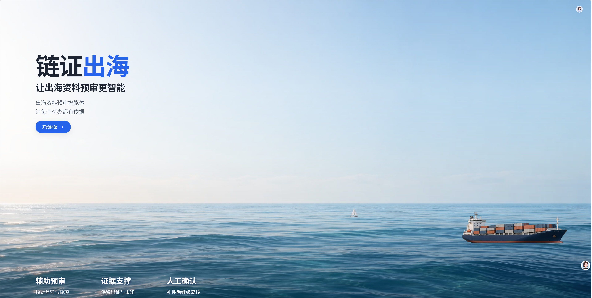
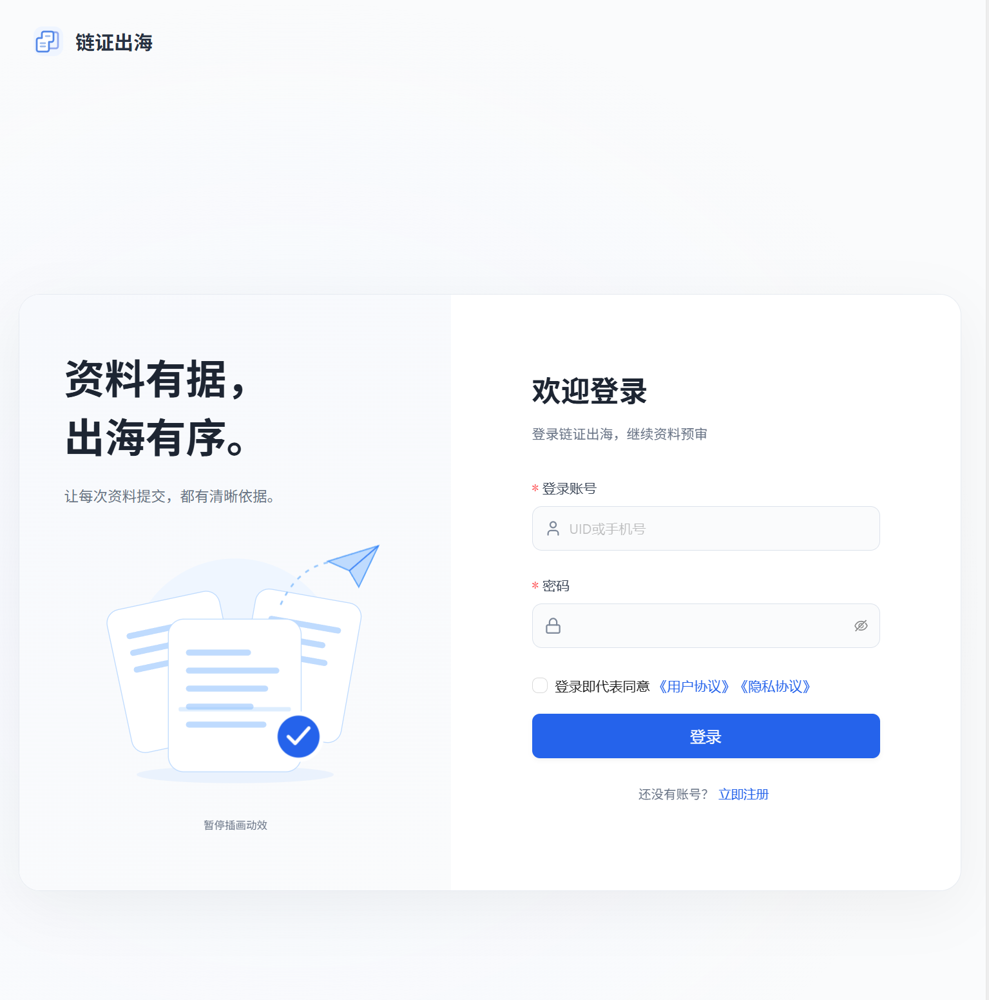
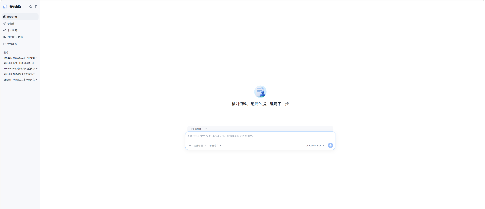
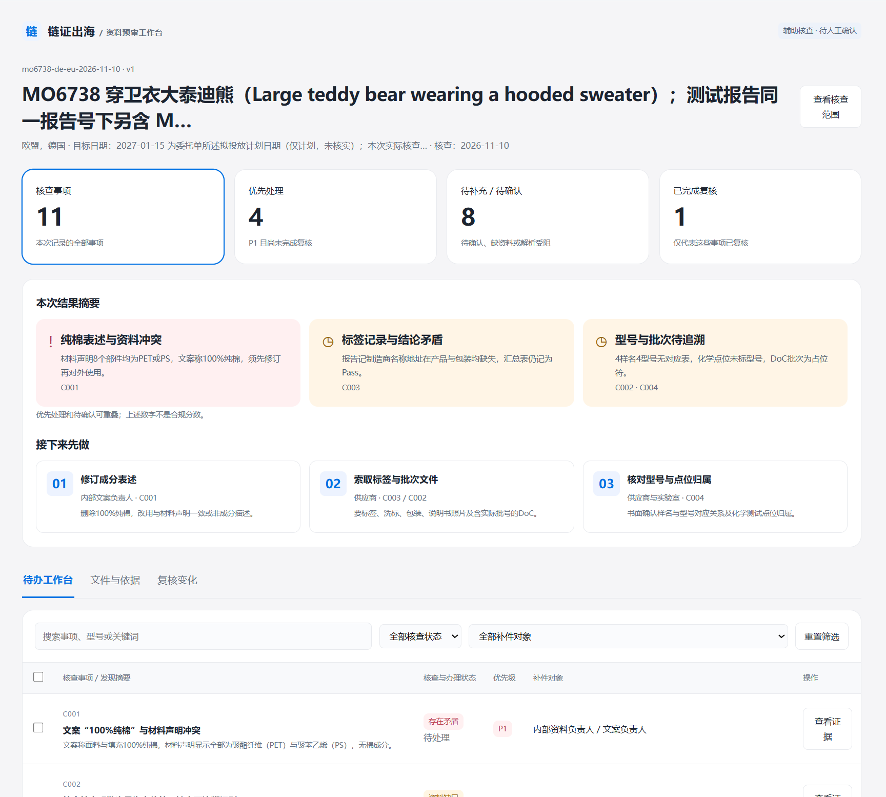
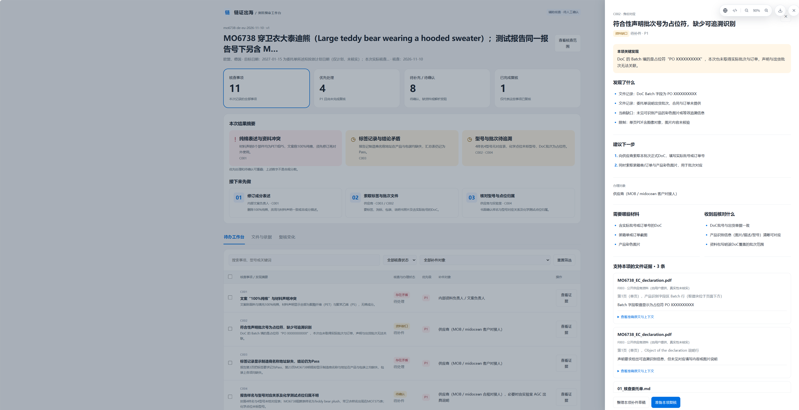

# ChuHai-agent | 链证出海

ChuHai-agent is an export-document pre-review assistant. It helps users organize export materials, identify inconsistencies and missing information, and prepare evidence-based findings and follow-up requests.

The project supports human review. Its output does not replace compliance certification, legal advice, or an official regulatory decision.

[中文](README.md) · [Review Skill setup](competition/core-skill-v1.2/安装与测试.md) · [Architecture](ARCHITECTURE.md)

## Capabilities

- Review product information, target markets, and uploaded documents in a conversation.
- Use document parsing, knowledge retrieval, and agent tools to organize evidence and items requiring confirmation.
- Use the review Skill to structure summaries, findings, evidence, follow-up suggestions, and a previewable dashboard.
- Configure models, knowledge bases, Skills, and a sandbox workspace for document processing.

Results depend on the configured model, tools, knowledge base, and input documents. Install and configure the review Skill and system prompt using the linked instructions.

## Interface gallery

### Home



### Sign in



### Agent workspace

Select an agent, model, and project, and reference files, knowledge bases, or Skills in a conversation.



### Review dashboard

View review items, priorities, missing materials, and suggested next steps in one place.



### Evidence and follow-up

Open a review item to see supporting documents, requested materials, and follow-up actions.



The review screenshots illustrate the interface and workflow; findings must be checked against the actual materials by a human.

## Get the code

This is a private repository; authenticate with a GitHub account that has access. The default `main` branch contains the current stable version:

```bash
git clone https://github.com/windisx/Chuhai-agnet.git
cd Chuhai-agnet
```

To get subsequent development updates, clone the development branch:

```bash
git clone --branch feat/chuhai-ui-polish https://github.com/windisx/Chuhai-agnet.git
cd Chuhai-agnet
```

The repository name is spelled `Chuhai-agnet` on GitHub. The development branch may contain changes not yet merged into `main`.

## Start on a new computer

The following starts the Docker Compose development environment; a complete deployment on a fresh computer has not yet been verified. The first build downloads dependencies and images, so its duration and resource usage depend on the machine and network.

1. Install Git, Docker Desktop or Docker Engine, and Docker Compose. Prepare a model provider API key.
2. Run the initialization script from the repository root. It prompts for a SiliconFlow API key and can generate independent security secrets; web search keys are optional.

   Windows PowerShell:

   ```powershell
   .\scripts\init.ps1
   ```

   Linux / macOS:

   ```bash
   ./scripts/init.sh
   ```

   For another supported provider, configure the environment using [.env.template](.env.template). When configuring manually, set three independent security secrets of at least 32 characters each: `JWT_SECRET_KEY`, `API_KEY_DERIVATION_SECRET`, and `SANDBOX_PROVISIONER_TOKEN`. Do not commit `.env` or secrets.

3. Build and start the services:

   ```bash
   docker compose up --build -d
   docker compose ps
   ```

4. With the default development configuration, open [http://localhost:5173](http://localhost:5173); API documentation is at [http://localhost:5050/docs](http://localhost:5050/docs). Once the services are ready, follow the on-screen instructions to initialize an account and sign in.

The existing development computer uses an additional port override and serves the web UI at `http://localhost:25173`; a fresh installation uses the ports configured on that computer.

Configure the model, agent, and any knowledge base separately on the new installation. The repository contains code and committed project files, not existing accounts, knowledge bases, API keys, or runtime data. See the [Skill setup guide](competition/core-skill-v1.2/安装与测试.md) and [agent setup instructions](competition/core-skill-v1.2/新建智能体使用说明.md).

The review Skill ZIP is not included in the repository. First compress the entire `competition/core-skill-v1.2/export-document-review/` directory as `export-document-review.zip`, preserving the directory and its files, and then upload it as described in the guides. Configure the system prompt separately.

Self-registration currently grants superadministrator privileges; adjust registration and authorization before exposing the site publicly. A tunnel provides an access route, but the host computer must remain powered on, connected, and running both Docker and the tunnel client.

## Project layout

| Path | Contents |
| --- | --- |
| `web/` | Vue frontend and visual assets |
| `backend/` | FastAPI backend, agent runtime, and tests |
| `competition/core-skill-v1.2/` | Export-document review Skill, prompt, and instructions |
| `docker-compose.yml`, `docker/` | Development services and image configuration |
| `docs/` | Platform usage and development documentation |

## Acknowledgments and license

This project is built on [Yuxi](https://github.com/xerrors/Yuxi). Thanks to its contributors. [LICENSE](LICENSE) retains the upstream MIT license and copyright notice; third-party components are subject to their own licenses.
