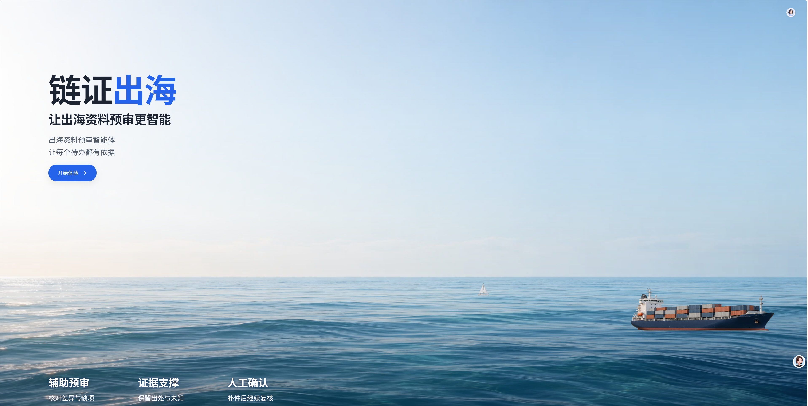
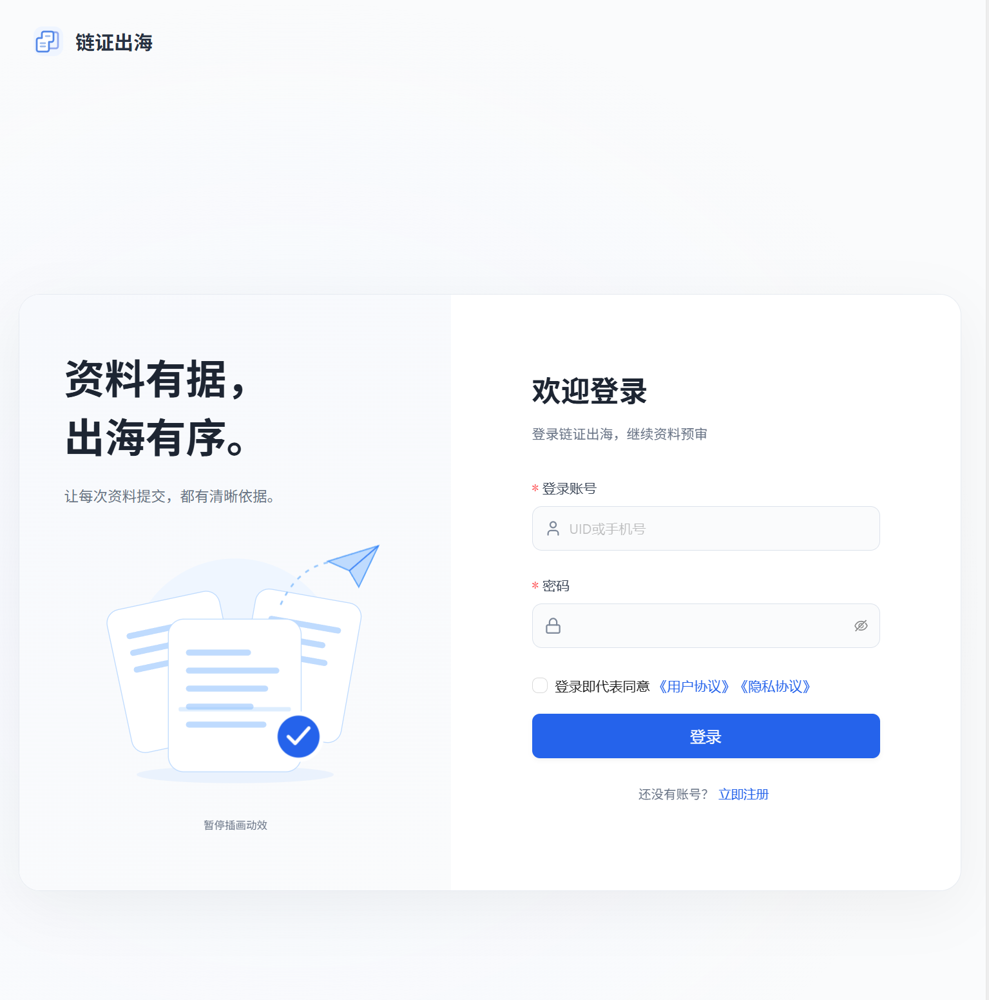
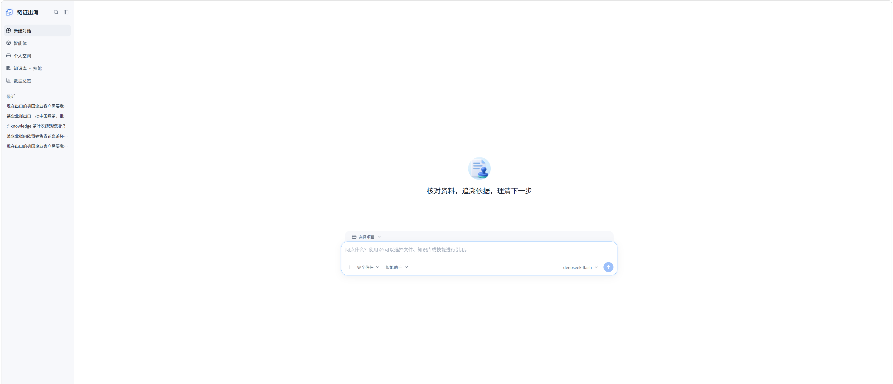
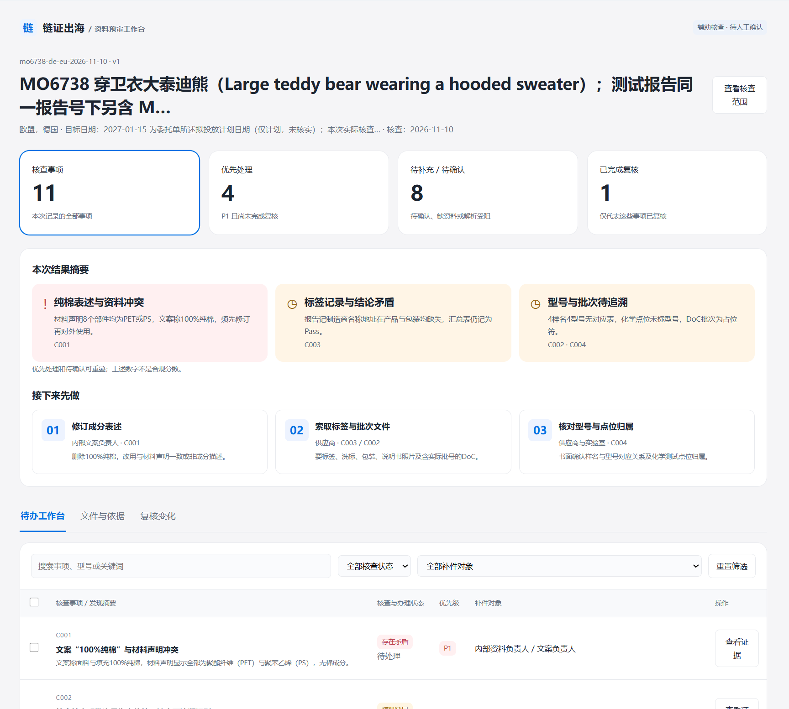
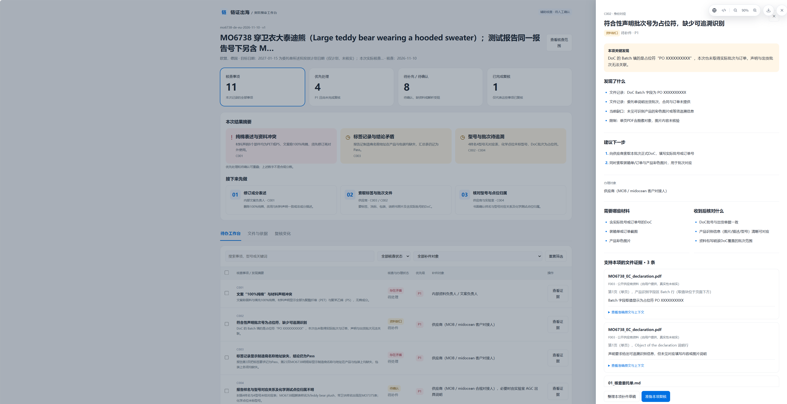

# ChuHai-agent｜链证出海

**链证出海**是一个面向出口业务的资料预审智能体项目，帮助业务人员整理出口资料，发现文件之间的矛盾、资料缺口和需要人工确认的事项，并生成有依据的核查结果与后续补件建议。

本项目用于辅助预审，输出需要人工核验，不能替代合规认证、法律意见或正式的监管判断。

[English](README.en.md) · [预审 Skill 使用说明](competition/core-skill-v1.2/安装与测试.md) · [系统架构](ARCHITECTURE.md)

## 项目功能

- 在对话中结合产品信息、目标市场和上传资料开展预审。
- 借助文件解析、知识库检索和智能体工具，整理文件证据与待确认事项。
- 通过预审 Skill 组织摘要、事项、证据、补件建议和可预览的看板。
- 使用模型配置、知识库、Skills 和沙盒工作区支持资料处理。

实际结果取决于模型、工具、知识库和输入资料的配置；预审 Skill 和系统提示词需要按说明安装配置。

## 界面展示

### 首页



### 登录页面



### 智能体工作台

在对话中选择智能体、模型和项目，并引用文件、知识库或技能。



### 资料预审看板

集中查看核查事项、优先级、待补充内容和下一步建议。



### 证据与后续操作

展开单项核查结果，查看相关文件证据、需要的材料和建议的复核动作。



以上预审截图用于展示界面和工作流程，具体核查结果需结合实际资料由人工确认。

## 获取代码

仓库是私有仓库，克隆前需使用有权限的 GitHub 账号完成认证。默认 `main` 分支保存当前稳定版本：

```bash
git clone https://github.com/windisx/Chuhai-agnet.git
cd Chuhai-agnet
```

如需获取后续开发中的更新，克隆开发分支：

```bash
git clone --branch feat/chuhai-ui-polish https://github.com/windisx/Chuhai-agnet.git
cd Chuhai-agnet
```

仓库名以 GitHub 上的实际拼写 `Chuhai-agnet` 为准。开发版本可能包含尚未合并到 `main` 的修改。

## 在新电脑上启动

以下是 Docker Compose 开发环境的启动方式；全新电脑上的完整部署尚未验证。首次构建需要下载依赖和镜像，耗时及资源占用取决于网络与电脑配置。

1. 安装 Git、Docker Desktop 或 Docker Engine，以及 Docker Compose，并准备模型服务的 API Key。
2. 在项目根目录执行初始化脚本。脚本会提示输入 SiliconFlow API Key，并可生成独立的安全密钥；联网搜索密钥可按提示选择。

   Windows PowerShell：

   ```powershell
   .\scripts\init.ps1
   ```

   Linux / macOS：

   ```bash
   ./scripts/init.sh
   ```

   如需使用其他受支持的模型供应商，也可参照 [.env.template](.env.template) 手动配置。手动配置时，还需为 `JWT_SECRET_KEY`、`API_KEY_DERIVATION_SECRET` 和 `SANDBOX_PROVISIONER_TOKEN` 分别设置不少于 32 个字符的独立安全密钥。不要将 `.env` 和密钥提交到仓库。

3. 构建并启动服务：

   ```bash
   docker compose up --build -d
   docker compose ps
   ```

4. 默认开发配置下，在浏览器打开 [http://localhost:5173](http://localhost:5173)；API 文档为 [http://localhost:5050/docs](http://localhost:5050/docs)。等待服务就绪后，按页面提示初始化账号并登录。

本机现有环境使用了额外的端口配置，因此访问地址是 `http://localhost:25173`；这不是新电脑默认端口。具体端口以该电脑的 Compose 配置为准。

新环境需要自行配置模型、智能体及所需知识库。Git 仓库只提供代码和已提交的项目文件，不包含现有账号、知识库、API 密钥或运行数据。安装预审能力时，请参考 [Skill 安装与测试](competition/core-skill-v1.2/安装与测试.md)及[新建智能体使用说明](competition/core-skill-v1.2/新建智能体使用说明.md)。

预审 Skill 的 ZIP 包不包含在仓库中。新电脑需先将 `competition/core-skill-v1.2/export-document-review/` 整个目录压缩为 `export-document-review.zip`，保留目录及其中的文件，再按上述说明上传；系统提示词需要单独配置。

当前自助注册会授予超级管理员权限，接入公网前应先调整注册和权限配置。内网穿透只提供访问入口，运行网站的电脑仍需保持开机、联网并运行 Docker 和穿透客户端。

## 项目结构

| 路径 | 内容 |
| --- | --- |
| `web/` | Vue 前端和界面素材 |
| `backend/` | FastAPI 后端、智能体运行逻辑与测试 |
| `competition/core-skill-v1.2/` | 出海资料预审 Skill、提示词和使用说明 |
| `docker-compose.yml`、`docker/` | 开发环境服务与镜像配置 |
| `docs/` | 平台使用和开发文档 |

## 开源来源与许可证

本项目基于开源项目 [Yuxi](https://github.com/xerrors/Yuxi) 开发，感谢原项目贡献者。[LICENSE](LICENSE) 保留了原项目的 MIT 许可证及版权声明；第三方组件遵循各自的许可证。
